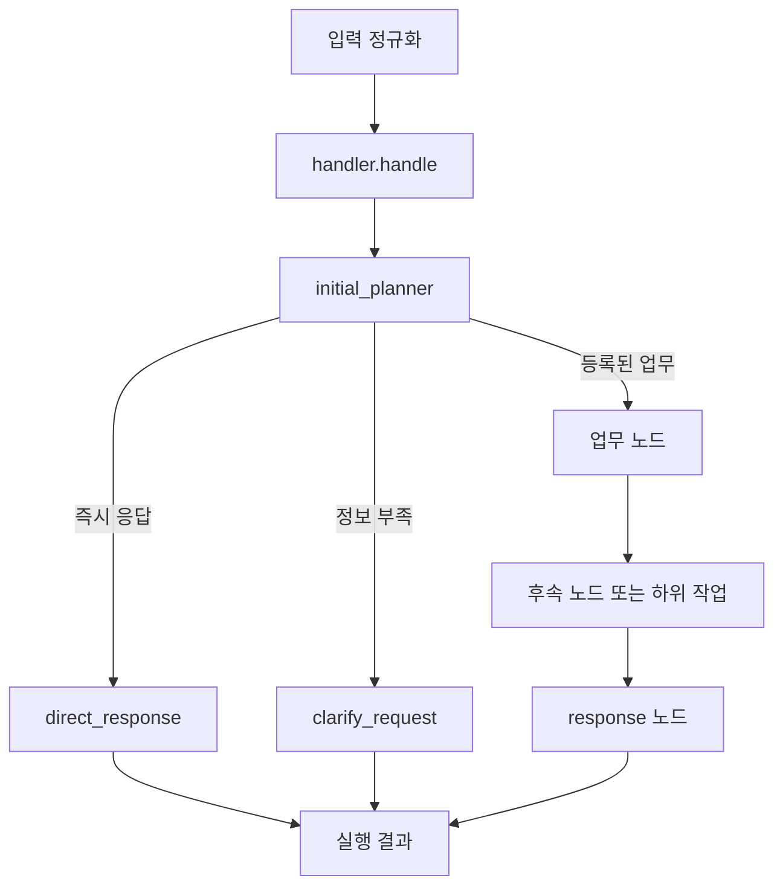

# 에이전트 구성

이 프로젝트는 입력을 받아 등록된 노드와 도구를 실행하고 문자열 응답을 반환하는 Python 에이전트 코어입니다. 웹 서버나 배포 플랫폼은 포함하지 않습니다.

## 주요 파일

| 파일 | 역할 |
|---|---|
| `python/simple_agent/handler.py` | 업무 로직 진입점. `handle(input_data, tools)`가 응답 문자열을 반환합니다. |
| `python/simple_agent/planner.py` | 요청 분류, 노드 선택, 기본 응답과 추가 질문 노드 |
| `python/simple_agent/workflow.py` | 노드 선언, 단계 전이 규칙, 워크플로 실행 |
| `python/simple_agent/node_execution.py` | 노드 실행, 반환 검증, 선언된 재시도 정책 |
| `python/simple_agent/tools.py` | 노드와 도구 등록부, 스키마·권한 검사 |
| `python/simple_agent/engine.py` | 입력 정규화와 한 번의 에이전트 실행 |
| `python/simple_agent/runtime.py` | 실행 문맥, 단계 기록, 도구 작업 수명 관리 |
| `python/simple_agent/transport.py` | 모델 제공자 요청의 공통 인터페이스 |
| `python/simple_agent/fixtures.py` | 네트워크 없이 모델 응답 경로를 확인하는 가상 transport |
| `tests/e2e/agent.py` | 별도 Python 프로세스에서 실제 핸들러 경로를 확인하는 E2E |

## 실행 흐름

기본 핸들러는 `planner.run_default`를 호출합니다. 기본 등록에는 `initial_planner`, `direct_response`, `clarify_request`만 있으므로, 업무를 처리하려면 업무 노드를 코드로 추가하고 등록해야 합니다.

## 기본 계약

- 핸들러는 `async def handle(input_data, tools)` 형식이며 비어 있지 않은 문자열을 반환합니다.
- `input_data`에는 이번 요청과 파일 참조가 들어옵니다. 과거 대화나 파일 내용이 자동으로 모두 전달된다고 가정하지 않습니다.
- `tools.invoke(name, arguments)`는 등록된 도구만 명시적으로 실행합니다. 도구 스키마와 권한을 통과해야 합니다.
- 노드 연결은 코드로 선언합니다. 모델이 새 노드나 권한을 만들어 실행하지 않습니다.
- 기본 저장소는 프로세스 내 메모리입니다. 프로세스 종료 후에도 남는 저장소는 별도로 연결해야 합니다.
- 실제 모델 호출은 호출자가 `Config`와 `Transport`로 구성합니다. E2E는 가상 응답을 사용합니다.

노드 작성은 [워크플로 가이드](workflow.md), 모델 입력과 노드 지시 작성은 [업무 프롬프트 안내](../prompts/agent.md)을 참고하세요.
